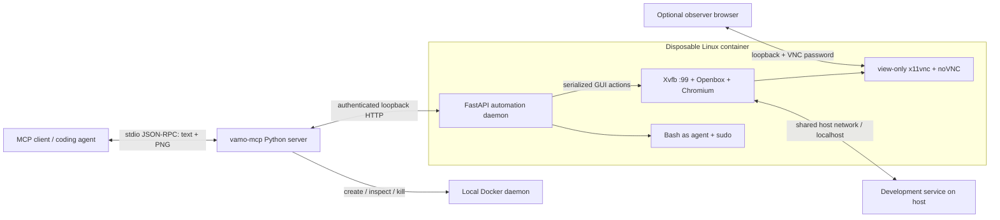

# vamo-mcp — Disposable Desktop MCP Server for AI Agents

**Give your AI coding agent its own Linux desktop, browser, and terminal—without taking over your mouse, keyboard, or screen.**

vamo-mcp is a local **Model Context Protocol (MCP) server** for **computer use, visual browser automation, and disposable desktop testing**. Each MCP process manages an ephemeral Docker container running **Xvfb, Openbox, Chromium, and an authenticated automation daemon**. Agents receive real screenshots, interact with a private 1280×800 desktop, run shell commands, and optionally let you watch through **read-only noVNC**.

Connect it to **Claude Code, Cursor, OpenCode, PI**, or another MCP client with stdio and image-tool support. No paid browser service, remote desktop account, or access to your physical display is required.

> **Security boundary:** filesystem, process, and display isolation—not network isolation. Containers use **host networking** and can reach host services. Read-write workspace mounts change real files. This is for trusted local automation, **not a VM or a sandbox for hostile code**.

[One-line install](#one-line-install) · [Agent skill](#agent-skill) · [MCP client configuration](#mcp-client-configuration) · [Tools](#mcp-tools) · [Architecture](#architecture) · [Security](#security-and-isolation-model) · [Tests](#testing-and-verification) · [Troubleshooting](#troubleshooting)

## Why a separate desktop?

Computer-use agents that operate on your normal desktop can steal focus, move your pointer, type into the wrong window, or block you from working. vamo-mcp gives the agent a separate graphical session with its own browser profile and clipboard.

Use it for:

- **Visual testing of local web applications:** open `http://localhost:3000`, `:5173`, or another host service in container Chromium.
- **AI computer use:** click, drag, scroll, type, send key combinations, and inspect screenshots.
- **Browser debugging and exploratory QA:** see what Chromium actually renders, including errors and non-2xx pages.
- **Disposable Linux workflows:** install packages with sudo, run commands, and discard container-local changes.
- **Parallel coding agents:** separate containers, displays, credentials, and service ports per MCP process.
- **Human observation:** watch the same desktop in a browser tab without injecting input through VNC.

This is a pixel-based desktop automation server, not a Playwright wrapper or a DOM-only browser API. Navigation waits are fixed delays, not assertions of network-idle or HTTP success.

## Features

- **Six MCP tools** covering lifecycle, GUI actions, URL navigation, shell execution, and status.
- **13 computer actions**, each returning the current desktop as a lossless PNG with a visible cursor overlay.
- **Private X11 session:** Xvfb `:99`, 1280×800, Openbox, Debian Chromium, per-container Xauthority cookie.
- **Low-latency HTTP action path:** no `docker exec` per tool action; persistent HTTP connection and a single GUI/capture thread.
- **Real screenshots:** MSS in-memory capture, Pillow encoding, and scrot fallback; never a fabricated image.
- **Unicode typing** through the container-local clipboard; ASCII text passed literally, not evaluated by a shell.
- **Shell output and timeout handling:** background children do not keep response pipes open; partial output survives timeout.
- **Optional workspace mounting:** no host directory mounted by default; explicit mounts are read-only unless `rw` is requested.
- **Authenticated, loopback-only services:** Bearer-protected daemon, password-protected VNC, per-session ports.
- **Automatic teardown** on normal exit, stdio EOF, and handled SIGINT/SIGTERM; explicit destroy is idempotent.

## Requirements and platform status

| Requirement | Details |
|---|---|
| Python | 3.11 or newer |
| Package runner | [uv](https://docs.astral.sh/uv/getting-started/installation/) recommended; standard pip also works |
| Docker | Local Docker Engine with Linux containers, or Docker Desktop with host networking |
| Docker CLI | Required to resolve the active Docker context when `DOCKER_HOST` is unset |
| MCP client | Local stdio transport; image content support for visual tools |
| Tested platform | Linux x86_64, Docker Engine 29.7.2, Python 3.14.7 host / Python 3.11 image |
| Implemented but not exercised here | macOS and Windows Docker Desktop paths |

For **Docker Desktop on macOS or Windows**, use version **4.34 or newer**, switch to **Linux containers**, enable **Settings → Resources → Network → Enable host networking**, and disable **Enhanced Container Isolation**. Authorize the mounted workspace in Docker Desktop file-sharing settings when required. See [Docker host networking documentation](https://docs.docker.com/engine/network/drivers/host/).

Remote Docker daemons, rootless Docker, and Windows containers are rejected because they do not satisfy the shared-localhost contract. There is no automatic bridge-network fallback and no automatic modification of Docker settings.

## Quick start

### One-line install

With **uv, Git, and a running local Docker installation** already available, install the CLI in an isolated tool environment and build the desktop image directly from GitHub:

```sh
uv tool install 'git+https://github.com/alanfrigo/vamo-mcp.git' && docker build -t ephemeral-desktop-sandbox:latest 'https://github.com/alanfrigo/vamo-mcp.git#main:sandbox_image'
```

Works in POSIX shells and PowerShell 7+. Windows PowerShell 5.1: run the two commands separately and only build after installation succeeds. Docker Desktop prerequisites above still apply. The image build downloads Debian packages and Python dependencies; this is not a prebuilt image pull.

No installer script, global Python package installation, automatic sudo, shell-profile edits, or MCP client configuration changes. **Installing from GitHub executes project/build code; review the repository before running it.** For reproducible installs, pin the Python Git URL to `@<commit-sha>` and replace `main` in the Docker URL with that same SHA.

Find the installed executable with `uv tool dir --bin`; use the absolute `vamo-mcp` path in your MCP client if that directory is not on its PATH. Launch command after this install is **`vamo-mcp`**, without `uv run` or a checkout directory. Minimal Claude/Cursor/PI configuration:

```json
{
  "mcpServers": {
    "ephemeral-sandbox": {
      "type": "stdio",
      "command": "/ABSOLUTE/PATH/TO/vamo-mcp",
      "args": []
    }
  }
}
```

Use `vamo-mcp.exe` on Windows. OpenCode uses `{"mcp":{"ephemeral-sandbox":{"type":"local","command":["/ABSOLUTE/PATH/TO/vamo-mcp"],"enabled":true}}}`. The checkout-based examples below remain an alternative, not another required installation step. To update a tool installation, use `uv tool upgrade vamo-mcp` and rebuild the image from the matching revision. To remove it, use `uv tool uninstall vamo-mcp`; Docker images and separately installed skills are not removed automatically.

### Install from a checkout

```sh
git clone https://github.com/alanfrigo/vamo-mcp.git
cd vamo-mcp
uv sync --extra test
docker build -t ephemeral-desktop-sandbox:latest sandbox_image
```

Then configure your MCP client using the examples below. To launch the stdio server directly:

```sh
uv run vamo-mcp
# Equivalent module entry point:
uv run python -m ephemeral_desktop_mcp.server
```

The server speaks JSON-RPC over stdin/stdout; it is not an interactive shell or a web UI. Docker access is lazy: a desktop is created only when a client calls `sandbox_init`. The image must already exist; tool calls do not silently build or pull it.

Optional shortcuts: `make build`, `make test`, and `make run`. The direct commands work without Make.

### Without uv on PATH

Bootstrap uv in a local virtual environment, without installing into the system Python:

```sh
python3 -m venv .venv-tools
.venv-tools/bin/python -m pip install uv
.venv-tools/bin/uv sync --extra test
```

Windows PowerShell:

```powershell
py -m venv .venv-tools
.venv-tools\Scripts\python.exe -m pip install uv
.venv-tools\Scripts\uv.exe sync --extra test
```

Use the **absolute path** to `.venv-tools/bin/uv` or `.venv-tools\Scripts\uv.exe` as the client executable if `uv` is not on that client's PATH. MCP clients launched from a GUI may not inherit your terminal PATH.

Alternatively, install the checkout using a regular virtual environment and run its `vamo-mcp` executable:

```sh
python3 -m venv .venv
.venv/bin/python -m pip install -e '.[test]'
.venv/bin/vamo-mcp
```

The Docker image build is still required. These instructions install from source; they do not imply a published PyPI package or prebuilt registry image.

## Agent skill

MCP tools work without a skill: clients discover their schemas and descriptions through MCP. The optional [vamo-mcp Agent Skill](skills/vamo-mcp/SKILL.md) teaches agents when and how to use the private desktop, inspect screenshots, diagnose failures, respect workspace/network boundaries, and clean up the session instead of controlling your physical display.

Install it into your current project with the [Skills CLI](https://github.com/vercel-labs/skills) (requires Node.js/npm):

```sh
npx skills add alanfrigo/vamo-mcp --skill vamo-mcp
```

Choose your agent and scope when prompted. For a noninteractive Claude Code project install:

```sh
npx skills add alanfrigo/vamo-mcp --skill vamo-mcp --agent claude-code --yes
```

Use `--agent cursor`, `--agent opencode`, or `--agent pi` for those clients; `--global` explicitly requests user-wide installation. Review the skill and installer before granting access to agent directories. No skill is installed implicitly by the MCP CLI or Docker image.

The skill follows the [Agent Skills specification](https://agentskills.io/specification): `skills/vamo-mcp/SKILL.md` contains discovery metadata and instructions, without hard-coded harness tool prefixes or an automatic permission grant. You can also copy its directory into a skill location supported by your client.

**Skill installation does not install Docker, build the image, configure the MCP server, or grant shell/file permissions.** Complete the server installation and MCP configuration too. Reload your client after adding the skill/configuration; check that it exposes the six sandbox tools. Skill and MCP are separate: guidance versus executable capabilities.

## MCP client configuration

Build the Docker image first. Replace `/ABSOLUTE/PATH/TO/vamo-mcp` with the absolute checkout directory. Keep the server key `ephemeral-sandbox`, or choose your own client-side name.

### Claude Code

Project `.mcp.json`:

```json
{
  "mcpServers": {
    "ephemeral-sandbox": {
      "type": "stdio",
      "command": "uv",
      "args": ["--directory", "/ABSOLUTE/PATH/TO/vamo-mcp", "run", "vamo-mcp"]
    }
  }
}
```

CLI alternative:

```sh
claude mcp add --scope project --transport stdio ephemeral-sandbox -- uv --directory /ABSOLUTE/PATH/TO/vamo-mcp run vamo-mcp
```

Approve the project MCP server when prompted. [Claude Code MCP documentation](https://code.claude.com/docs/en/mcp-quickstart).

### Cursor

Create `.cursor/mcp.json`:

```json
{
  "mcpServers": {
    "ephemeral-sandbox": {
      "type": "stdio",
      "command": "uv",
      "args": ["--directory", "/ABSOLUTE/PATH/TO/vamo-mcp", "run", "vamo-mcp"]
    }
  }
}
```

[Cursor MCP documentation](https://cursor.com/docs/context/mcp).

### OpenCode

Create or merge into `opencode.json`. OpenCode uses **`mcp`**, not `mcpServers`, and a command array:

```json
{
  "$schema": "https://opencode.ai/config.json",
  "mcp": {
    "ephemeral-sandbox": {
      "type": "local",
      "command": ["uv", "--directory", "/ABSOLUTE/PATH/TO/vamo-mcp", "run", "vamo-mcp"],
      "enabled": true
    }
  }
}
```

[OpenCode MCP documentation](https://docs.opencode.ai/docs/mcp-servers/).

### PI

Use native MCP support in `.pi/mcp.json` for the project or `~/.pi/agent/mcp.json` globally:

```json
{
  "mcpServers": {
    "ephemeral-sandbox": {
      "type": "stdio",
      "command": "uv",
      "args": ["--directory", "/ABSOLUTE/PATH/TO/vamo-mcp", "run", "vamo-mcp"]
    }
  }
}
```

```sh
pi mcp add -l ephemeral-sandbox -- uv --directory /ABSOLUTE/PATH/TO/vamo-mcp run vamo-mcp
pi mcp list --json
```

Trust the project to load its local configuration; `/reload` applies changes. If an extension replaces `/mcp`, use the native support described in the [PI MCP documentation](https://pi.dev/docs/latest/mcp), rather than assuming an unknown extension accepts the same configuration.

### Other MCP clients

Run `vamo-mcp` as a local stdio subprocess with the project environment available. The protocol is standard MCP, using the official Python SDK v1 FastMCP implementation. Clients need image-tool support to consume screenshots. No personal client configuration is written by project installation.

## First workflow

Start your development server on the host, then ask your agent:

> Initialize the desktop sandbox without mounting my workspace. Open http://localhost:5173, inspect the screenshot, click through the application, and report what you observe. Keep all GUI input inside the sandbox. Destroy the sandbox when finished.

Example MCP tool arguments, in order:

1. `sandbox_init`: `{"forward_ports":[5173]}`
2. `sandbox_open_url`: `{"url":"http://localhost:5173","wait_seconds":2}`
3. `sandbox_computer_action`: `{"action":"left_click","coordinate":[220,260]}` — choose coordinates from the screenshot, not this illustrative position.
4. `sandbox_bash`: `{"command":"pwd; id","take_screenshot_after":true}`
5. `sandbox_destroy`: `{}`

`localhost` inside Chromium reaches host services because the container shares the host network. **`forward_ports` is only declared metadata: it neither creates forwarding nor restricts access to other ports.**

## MCP tools

| Tool | Purpose and defaults |
|---|---|
| `sandbox_init` | Create/reuse/reset a session. `workspace_path=null`, `mount_mode="ro"`, `forward_ports=[3000,5173,8000,8080]`, `reset_if_running=false` |
| `sandbox_computer_action` | Perform a GUI action and return text metadata plus an `image/png` MCP content block |
| `sandbox_open_url` | Open HTTP/HTTPS in Chromium, restart it if stopped, wait `wait_seconds=2`, then return a screenshot |
| `sandbox_bash` | Run Bash as `agent`. `cwd="/workspace"`, `timeout=30`, `take_screenshot_after=false` |
| `sandbox_status` | Inspect without creating a container: `not_initialized`, `running`, `unhealthy`, or `stopped` |
| `sandbox_destroy` | Immediately terminate only this process's container and discard its private state; safe to repeat |

GUI and shell tools never initialize a session implicitly. Call `sandbox_init` first.

### Computer actions and input rules

Supported action names:

```text
mouse_move       left_click       right_click      middle_click
 double_click    triple_click     left_click_drag  scroll
 type            key              wait             screenshot
 cursor_position
```

- Coordinates are strict integer pairs `[x,y]`, with `0 <= x < 1280` and `0 <= y < 800`. Booleans, floats, incomplete pairs, and out-of-bounds coordinates are rejected.
- `mouse_move` requires `coordinate`. Drag requires both `start_coordinate` and destination `coordinate`.
- Clicks and scrolling without coordinates use the current cursor position.
- Scroll supports `up`, `down`, `left`, and `right`; `scroll_amount=5` must be a positive integer.
- `type` and `key` require `text`. Empty typing is allowed; an empty key combination or NUL-containing text is not.
- Key aliases include `Enter`, `Esc`, `BackSpace`, `Ctrl+A`, and `Cmd+L`; named X keysyms such as `Control_L` and `F4` are supported.
- ASCII uppercase letters in Ctrl/Alt/Super shortcuts are lowercased unless Shift is explicit: `Ctrl+A` means `ctrl+a`. Standalone uppercase letters and `Ctrl+Shift+A` retain their X11 semantics.
- Unicode typing uses the private container clipboard; ASCII typing is literal, including quotes, newlines, and text such as `$(...)`.
- `duration=1.0` controls only `wait`; durations must be finite and nonnegative. Drag is a direct movement, not interpolated animation.
- Clicks, drag, scroll, typing, and keys include a deliberate 150 ms repaint delay. Screenshot, cursor position, and mouse movement have no fixed repaint delay.

Every successful action returns the actual current screenshot, including `wait` and `cursor_position`. Invalid combinations and extra fields are rejected before action execution. POST actions have **no automatic retry**: a response timeout does not prove the action failed to execute.

### Shell behavior

Commands run in `/bin/bash -lc` as UID 1000 with passwordless sudo and `DISPLAY=:99`. `/workspace` exists and is writable when no host mount is supplied. `cwd` must be an existing absolute directory; missing directories are not created implicitly.

The result includes `stdout`, `stderr`, and the actual `exit_code`. Nonzero exits set MCP `isError=true`. Background processes do not hold the response open through inherited output pipes. Timeout returns code `124`, preserves partial output, and terminates the shell's process group. A child deliberately detached using `setsid` may survive that timeout until container destruction.

With `take_screenshot_after=true`, an image is added even after a nonzero exit when capture is possible. A capture failure preserves command output and adds `screenshot_error` instead of discarding the shell result.

### Workspace mounting and reset

No host workspace is mounted by default. For an explicit mount:

```json
{
  "workspace_path": "/absolute/path/to/your/project",
  "mount_mode": "ro"
}
```

Paths must exist and be directories; `~` is expanded. Use `rw` only when the agent should modify real host files. UID mismatches may require sudo inside the container. The manager does not create host directories or change their ownership/permissions.

Each MCP process owns at most one container. An identical init reuses a healthy session. Changed configuration or an unhealthy session requires `reset_if_running=true`. Reset replaces the container and clears its private `/tmp`, browser profile, and filesystem; **host-mounted files remain unchanged by teardown, including prior `rw` edits**.

### Watching with noVNC

`sandbox_init` returns `container_id`, `daemon_url`, `novnc_url`, `forwarded_ports`, `network_mode`, and `network_isolated`. Open `novnc_url` manually to watch the desktop. No host browser opens automatically.

VNC authentication is required and the server is view-only, even if a client disables its own view-only setting. The URL carries the session password in its fragment; treat the whole URL as a secret. The daemon Bearer token is not returned through MCP.

## Architecture



Host package: Python `mcp>=1.28.1,<2`, Docker SDK, httpx, Pydantic, and AnyIO. The official MCP SDK v1 is used because this project requires `mcp.server.fastmcp`; it does not use the separate `fastmcp` package.

Image: `debian:bookworm-slim` with native Debian Chromium, Xvfb, Openbox, xdotool, xclip, MSS, Pillow, FastAPI/Uvicorn, x11vnc, noVNC/websockify, and Supervisor. GUI readiness gates wait for a real display, window manager, and visible browser. Health also checks geometry and Supervisor process state.

MSS is created, reused, and closed in one dedicated GUI thread. A single-frame cache reuses PNG/Base64 **only after a fresh cursor query and fresh MSS grab match the full previous raw frame and cursor exactly**. Any pixel or cursor change forces encoding; no hash collision or stale-frame shortcut is used. MSS errors clear the cache before real scrot fallback.

The manager uses host networking, private filesystem/process namespaces, `init=True`, `shm_size="2g"`, auto-removal, and dropped `NET_RAW`/`NET_ADMIN` capabilities. It reserves three distinct loopback ports per session, authenticates readiness with a session ID, and retries actual bind collisions without terminating port occupants. No action-time Docker exec, bridge relay, or socat forwarding process is used.

### Repository layout

```text
.
├── pyproject.toml                  # vamo-mcp distribution and CLI
├── uv.lock                         # Host dependency resolution
├── Makefile                        # Optional build/test/run shortcuts
├── MANIFEST.in                     # Include Docker context in source distribution
├── sandbox_image/
│   ├── Dockerfile
│   ├── entrypoint.sh               # Validate env, protect X11, start Supervisor
│   ├── supervisord.conf
│   └── agent_daemon/
│       ├── main.py                 # HTTP actions, capture, shell, readiness gates
│       └── requirements.txt
├── src/ephemeral_desktop_mcp/
│   ├── __init__.py
│   ├── docker_manager.py           # Session lifecycle and authenticated requests
│   └── server.py                   # Six MCP tools and stdio shutdown
└── tests/test_e2e.py                # Real Docker/MCP behavioral acceptance checks
```

The public distribution/command is `vamo-mcp`; the Python module remains `ephemeral_desktop_mcp`, the local image is `ephemeral-desktop-sandbox:latest`, and container names start with `ephemeral-agent-sandbox-`.

## Security and isolation model

**Use for trusted local development automation, not adversarial workloads.** Docker, passwordless sudo, Chromium `--no-sandbox`, and shared host networking do not provide a hardened VM security boundary.

| Surface | Behavior |
|---|---|
| Physical desktop | No host mouse/keyboard devices, host X11/Wayland sockets, or physical display are mounted or controlled |
| Host files | No implicit HOME, credentials, or workspace mounts; only an explicitly requested workspace is mounted |
| Workspace writes | `ro` by default; `rw` modifies actual host files and is not rolled back |
| Network | Shared host networking; host services and other reachable network endpoints are accessible |
| Daemon | IPv4 loopback only, per-session Bearer token and response session identity; no docs/CORS surface |
| Observation | Loopback noVNC/VNC, per-session password, server-side view-only |
| Container privileges | Not privileged; no Docker socket, host PID/IPC mode, or disabled seccomp; sudo is intentionally available inside |
| X11 | Private filesystem socket and cookie; conflicting host abstract `:99` socket causes startup to abort |

Do not expose service ports through a reverse proxy without designing an appropriate security layer. Anyone given MCP shell access can run arbitrary commands inside the container and reach host network services. Do not publish credentials, noVNC URLs, or sensitive screenshots in issues.

### Cleanup guarantees and limits

Normal server exit, MCP stdio EOF, and handled SIGINT/SIGTERM trigger cleanup of the **owned container ID only**, including cancellation during initialization or long-running tools. Explicit `sandbox_destroy` is idempotent.

**SIGKILL, host failure, or an unavailable Docker daemon cannot guarantee synchronous cleanup.** Docker `auto_remove` removes a container when it stops; it does not stop a live container merely because the MCP process died abruptly. Keep the returned ID for targeted recovery:

```sh
docker rm -f <container_id>
```

Never use global prune or prefix-wide deletion to recover one session. Destruction discards the container filesystem/browser profile but cannot undo changes to `rw` host mounts.

## Testing and verification

Build the image, then run:

```sh
uv run --extra test python tests/test_e2e.py --standalone
uv run --extra test python tests/test_e2e.py
uv run --extra test python tests/test_e2e.py --benchmark
uv run --extra test python tests/test_e2e.py --observe
```

The suite uses real Docker containers, the official MCP stdio client, and a deterministic host fixture bound strictly to **`127.0.0.1:8765`**. An occupied fixture port causes a clear failure; tests never kill its occupant or bind it publicly. Tests do not move the host's physical pointer.

- **Standalone:** authenticated health, decoded 1280×800 PNGs, strict input validation, UID/sudo, shell background/timeout behavior, scrot fallback/failure, private X11, and pixel/cursor changes.
- **End-to-end:** exactly six tools, real browser clicks and background-color changes, all 13 actions, Unicode/literal input, key shortcuts, navigation errors, and Chromium restart.
- **Lifecycle:** read-only/read-write mounts, reset, parallel independent X99 displays, occupied default ports, injected real port collision, unavailable prerequisites, wrong token, and preserved shell output after capture failure.
- **Shutdown:** EOF, SIGINT, and SIGTERM during idle, shell, GUI, and initialization; owned containers must disappear.
- **Observe:** print a session noVNC URL for the operator; first Enter performs a click through MCP, second Enter closes the session.

Recorded Linux verification also included a real noVNC browser view: counter/color changed after an MCP click; observer input was refused even with client view-only disabled; an incorrect password was denied; valid reconnection and teardown succeeded.

**Client validation scope:** Claude Code connected and native PI listed all six tools using temporary configurations. The installed OpenCode binary returned `No MCP servers configured` for the temporary checkout; its connection was not proven. Cursor configuration was validated as JSON, but connection was not exercised. macOS/Windows Docker Desktop behavior has not been tested on native hosts here.

### Measured latency

Recorded on the Linux environment above, with a static desktop fixture, a persistent HTTP connection, 10 warmups, and 100 sequential samples per screenshot stage. Results are local measurements, not guarantees for other hardware or platforms.

| Stage | p50 (ms) | p95 (ms) |
|---|---:|---:|
| Raw MSS grab | 1.356 | 1.784 |
| Capture + cursor + PNG + Base64, unchanged frame | 7.005 | 9.003 |
| Capture with changed cursor, fresh PNG encoding | 34.174 | 36.302 |
| HTTP screenshot | 16.580 | 19.622 |
| MCP screenshot | 24.803 | 27.494 |
| MCP mutating key, 10 samples, includes 150 ms repaint | 222.572 | 223.367 |

The static-fixture p95 targets passed: MSS <10 ms, full capture <15 ms, HTTP screenshot <50 ms. Changed-frame encoding is reported separately; the <15 ms figure does **not** apply to every changing frame. PNG remains lossless at full resolution with cursor overlay (`compress_level=1`, `optimize=False`); no JPEG, downscaling, or omitted cursor.

## Running the image standalone

Managed MCP sessions choose ports and credentials automatically. Standalone defaults are daemon **9999**, noVNC **6080**, and VNC **5900**; all three must be distinct and available.

Required environment:

| Variable | Requirement |
|---|---|
| `SANDBOX_TOKEN` | Nonempty daemon Bearer token |
| `SANDBOX_SESSION_ID` | UUID |
| `VNC_PASSWORD` | Exactly 8 ASCII alphanumeric characters |
| `DAEMON_PORT` | Optional port, default 9999 |
| `NOVNC_PORT` | Optional port, default 6080 |
| `VNC_PORT` | Optional port, default 5900 |

POSIX example, generating credentials without printing them:

```sh
export SANDBOX_TOKEN="$(python3 -c 'import secrets; print(secrets.token_urlsafe(32))')"
export SANDBOX_SESSION_ID="$(python3 -c 'import uuid; print(uuid.uuid4())')"
export VNC_PASSWORD="$(python3 -c 'import secrets,string; print("".join(secrets.choice(string.ascii_letters+string.digits) for _ in range(8)))')"
docker run --rm --init --network host --shm-size 2g --cap-drop NET_RAW --cap-drop NET_ADMIN \
  -e SANDBOX_TOKEN -e SANDBOX_SESSION_ID -e VNC_PASSWORD ephemeral-desktop-sandbox:latest
```

Diagnostic command **inside the container**:

```sh
supervisorctl -c /etc/supervisor/supervisord.conf status
```

Supervisor's control socket is private Unix `/run/supervisor.sock`, not a TCP control endpoint. Standalone mode is useful for inspecting the image; it does not provide the host MCP manager's automatic lifecycle ownership.

## Troubleshooting

| Symptom | Check or action |
|---|---|
| Image missing | Run `docker build -t ephemeral-desktop-sandbox:latest sandbox_image` from the checkout |
| Cannot access Docker | Start Docker, select a local context, and fix endpoint permissions; do not run the MCP server with sudo |
| Host localhost unreachable on Desktop | Check Desktop >=4.34, host networking enabled, Linux containers, ECI disabled |
| Workspace mount rejected | Verify path exists and Docker Desktop file sharing authorizes it |
| Workspace permission denied | Check read-only mode and UID ownership; use container sudo where appropriate, not recursive host chmod |
| Different configuration / unhealthy session | Inspect `sandbox_status`; pass `reset_if_running=true` when deliberately replacing it |
| `Sandbox is not initialized` | Call `sandbox_init` before GUI or shell tools |
| X11 abstract socket conflict | Another server owns abstract `:99`; the sandbox deliberately refuses it and does not kill or control it |
| MCP client cannot find uv | Use its absolute executable path; GUI client PATH may differ from terminal PATH |
| Browser shows an error page | Inspect the actual screenshot; navigation completion does not assert HTTP 2xx or service readiness |
| Tool response times out | Do not blindly repeat a mutating action; it may already have executed |
| Container remains after abrupt death | Remove only the known ID with `docker rm -f <container_id>` |

## Contributing and project status

Initial version: **0.1.0**. Issues and pull requests are welcome at [alanfrigo/vamo-mcp](https://github.com/alanfrigo/vamo-mcp/issues).

For reproducible bug reports, include OS/architecture, Python and Docker versions, Docker context type, Desktop host-networking settings where relevant, the failing tool call, and redacted logs. State whether the problem occurs in standalone or MCP mode. Never attach session passwords, Bearer tokens, private workspace contents, or sensitive screenshots.

Before proposing behavior changes, run the real acceptance commands and preserve the documented network, mount, and cleanup semantics. Native macOS/Windows verification is especially useful; Linux results must not be relabeled as cross-platform evidence.
